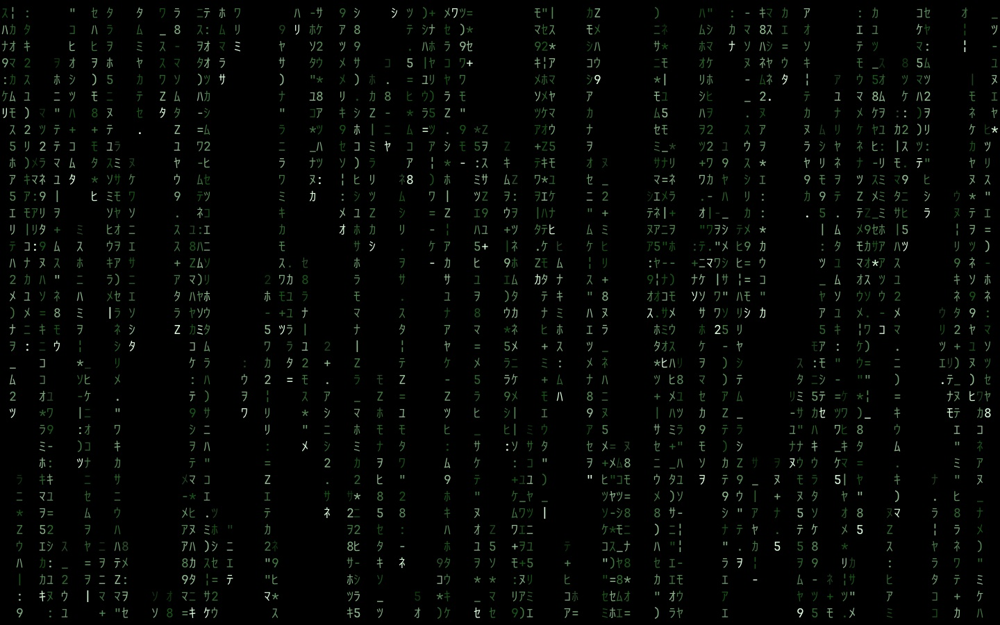
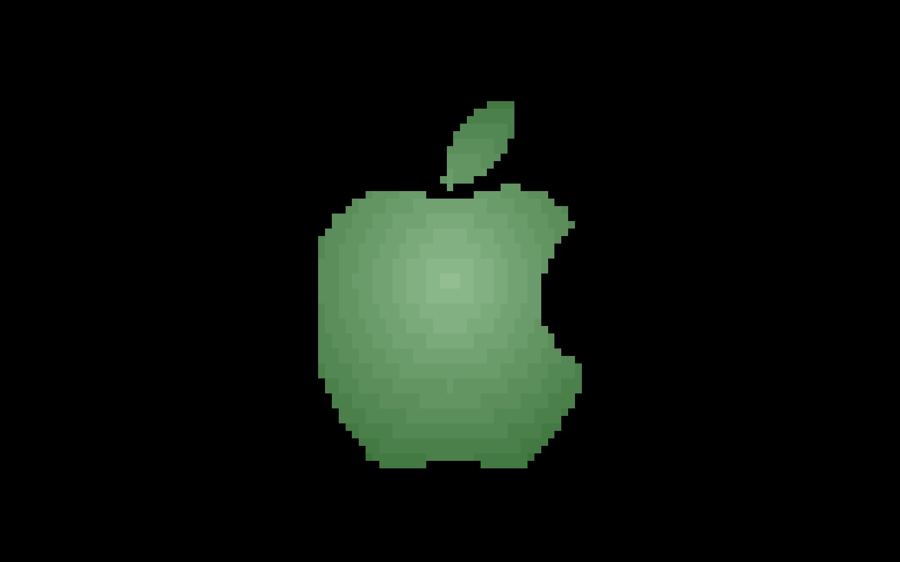

# Matrix — screensaver macOS

Pluie numérique façon *Matrix* qui finit par révéler le logo Apple.
Port Swift natif de l'effet `matrix` de [TerminalTextEffects](https://github.com/ChrisBuilds/terminaltexteffects)
(MIT), l'effet utilisé par le screensaver d'Omarchy (`omarchy-screensaver` → `tte … --frame-rate 120`).

Cycle : pluie 15 s → remplissage de l'écran → résolution du logo (dégradé radial vert) → pause 10 s → on recommence.




Compatible macOS 12 ou plus récent, Mac Intel et Apple Silicon (binaire universel).
Testé sur macOS 26 (Intel).

## Installation

### Option 1 — Terminal (recommandé)

```sh
curl -L -o /tmp/Matrix.saver.zip \
  https://github.com/bmarandel/matrix-screensaver/releases/latest/download/Matrix.saver.zip
mkdir -p ~/Library/"Screen Savers"
rm -rf ~/Library/"Screen Savers"/Matrix.saver
ditto -x -k /tmp/Matrix.saver.zip ~/Library/"Screen Savers"
killall legacyScreenSaver 2>/dev/null; true     # oublie une éventuelle ancienne version en cache
```

### Option 2 — Navigateur

1. Télécharger `Matrix.saver.zip` depuis la page
   [Releases](https://github.com/bmarandel/matrix-screensaver/releases/latest) et le décompresser
   (Safari le fait tout seul).
2. Double-cliquer sur `Matrix.saver` → **Installer pour cet utilisateur uniquement**.

Le bundle est signé en *ad hoc* (pas de certificat Apple Developer, pas de notarisation). Si macOS
refuse de l'ouvrir ou que l'économiseur reste vide, retirer l'attribut de quarantaine ajouté par le
navigateur, ou passer par **Réglages Système → Confidentialité et sécurité → Ouvrir quand même** :

```sh
xattr -dr com.apple.quarantine ~/Library/"Screen Savers"/Matrix.saver
killall legacyScreenSaver 2>/dev/null; true
```

### Choisir l'économiseur

**Réglages Système → Économiseur d'écran** → **Matrix** (section *Autre*).

Police : [JetBrains Mono Nerd Font](https://www.nerdfonts.com/font-downloads) si elle est installée
(`JetBrainsMonoNL Nerd Font Mono`), sinon Menlo, toujours présente.

### Désinstaller

```sh
rm -rf ~/Library/"Screen Savers"/Matrix.saver
killall legacyScreenSaver 2>/dev/null; true
```

puis choisir un autre économiseur dans les Réglages.

## Compiler depuis les sources

Prérequis : Xcode ou les Command Line Tools (`xcode-select --install`) pour `swiftc`, `lipo`,
`codesign`. Pas de projet Xcode : `build.sh` compile directement avec `swiftc`.

```sh
git clone https://github.com/bmarandel/matrix-screensaver.git
cd matrix-screensaver
./build.sh            # → build/Matrix.saver + build/Matrix.saver.zip (universel Intel + Apple Silicon)
./build.sh --install  # + copie dans ~/Library/Screen Savers et relance legacyScreenSaver
```

Ce que fait `build.sh` : compile une dylib par architecture, les fusionne avec `lipo`, assemble le
bundle (`Info.plist`, `Resources/`), retire les attributs étendus (`xattr -cr`, sinon `codesign` refuse :
*resource fork, Finder information… not allowed*), signe en ad hoc et zippe avec `ditto`.

Depuis macOS 14, le choix de l'économiseur n'est plus dans `defaults -currentHost com.apple.screensaver`
(ignoré) mais dans `~/Library/Application Support/com.apple.wallpaper/Store/Index.plist`, une entrée
`Idle` par écran et par Space — à savoir pour l'automatiser.

## Tester sans lancer l'économiseur

```sh
swiftc -O tools/preview.swift -o build/preview
build/preview build/Matrix.saver build/shots 3 17 23 26 44             # 1440×900, captures à ces secondes
build/preview build/Matrix.saver build/shots 2560x2160 15 60            # autre résolution
```

Charge le bundle hors écran, l'anime en temps réel (rendu Metal hors écran compris), enregistre
des captures PNG et mesure le temps CPU du processus. Mesures sur le MacBook Pro Intel :

| Résolution | CoreGraphics (v1.0.0) | Metal |
|---|---|---|
| 1440×900 | ~60 % d'un cœur | ~3 % |
| 2560×2160 | 96 % (plafonne à 16 fps) | ~8 % (~10 % mesuré dans `legacyScreenSaver`) |

## Tester et déboguer dans le vrai hôte

`tools/preview` ne reproduit pas l'hôte système : sous macOS 14+ l'économiseur tourne dans
`legacyScreenSaver`, affiché à distance (ViewBridge), lancé par `ScreenSaverEngine` ou par
`WallpaperAgent` (écran verrouillé). Pour un test réel (session déverrouillée, ne pas toucher la souris) :

```sh
./build.sh --install
open -a ScreenSaverEngine; sleep 4
P=$(pgrep -n legacyScreenSaver); ps -o time= -p $P; sleep 10; ps -o time= -p $P   # temps CPU sur 10 s
killall ScreenSaverEngine
```

- `killall ScreenSaverEngine` n'émet pas `willstop` : l'instance peut rester en vie, c'est normal ici.
- Traces : `os_log("…%{public}@…")` dans le code (sans `%{public}` le texte est masqué), puis
  `/usr/bin/log show --last 1m --predicate 'process == "legacyScreenSaver"'`.
  Dans zsh, `log` est une commande interne : toujours écrire `/usr/bin/log`.
- `screencapture` capture bien l'économiseur affiché : pratique pour vérifier qu'il n'est pas noir.
- Écran verrouillé : `ScreenSaverEngine` n'affiche rien et se ferme aussitôt ; tester session ouverte.

## Personnaliser

- **Logo** : `Resources/logo.txt` (art en blocs `█ ▀ ▄`, dessinés en rectangles pleins).
  Régénérer la pomme : `swift tools/make-logo.swift 40 > Resources/logo.txt` (40 = largeur en colonnes).
  N'importe quel texte/ASCII-art fonctionne aussi (ex. le `logo.txt` d'Omarchy).
- **Réglages** : enum `Cfg` en tête de `Sources/MatrixSaverView.swift` (couleurs, vitesse, durée de pluie,
  durée d'affichage du logo, police — JetBrains Mono Nerd Font, repli Menlo).

## Notes techniques

- **Fidélité à TTE** : même algorithme (colonnes, `hold_time`, `drop`, `trim`, phases rain → fill → resolve)
  et mêmes valeurs par défaut. TTE tourne à `--frame-rate 120` chez Omarchy : ici 30 fps × 4 ticks
  par frame (`Cfg.ticksPerFrame`) pour garder la même vitesse avec deux fois moins de rendu.
- **Rendu GPU (Metal)** — `Sources/MetalRenderer.swift` : à chaque (re)construction, les glyphes
  (repli de police automatique pour les katakanas demi-chasse) sont rastérisés une fois par CoreText
  dans un atlas 8 bits ; à chaque frame le CPU remplit seulement un tableau d'instances
  (12 octets par cellule visible) et le GPU dessine toute la grille en un appel instancié.
  Les blocs `█ ▀ ▄ ▌ ▐` sont des quads pleins aux bords arrondis au pixel : pas de jointures dans
  le logo. Le shader est compilé à l'exécution (`makeLibrary(source:)`), donc pas besoin de l'outil
  `metal` d'Xcode pour construire.
- **GPU utilisé** : celui qui pilote l'écran de la vue (`CGDirectDisplayCopyCurrentMetalDevice`) —
  pas de copie entre GPU ; sur l'écran interne seul c'est l'iGPU Intel, la Radeon n'est pas réveillée.
- **Résolution** : la grille est recalculée pour chaque écran — taille de police plafonnée à
  `Cfg.maxFontSize` points (taille physique constante, Retina ou non), réduite si le logo ne tient
  pas ; le nombre de colonnes/rangées découle de la taille de l'écran. Rendu en pixels physiques
  (`backingScaleFactor`). Reconstruction automatique si la taille, la densité ou l'écran changent.
- **Simulation** : générateur aléatoire wyrand (`FastRNG`) au lieu du générateur système
  cryptographique — la pluie tire ~160 000 nombres par frame (11 → 1,7 ms/frame en 2560×2160).
- **macOS 14+** : `legacyScreenSaver` ne libère pas les instances et continue à animer après la sortie
  (constaté : ~25 % CPU pendant 25 min après la fin de l'économiseur). Garde-fous :
  - `exit(0)` sur `com.apple.screensaver.willstop` **et** `com.apple.screenIsUnlocked`
    (willstop n'est pas émis au déverrouillage par mot de passe) — hors aperçu des Réglages ;
  - logo figé dessiné une seule fois au lieu de 30 fois par seconde.
  - À ne pas faire : se fier à `occlusionState` — dans l'hôte ViewBridge la fenêtre se déclare
    toujours masquée (valeur 8192, sans le bit `.visible`), même affichée → écran noir.
  - À ne pas faire : quitter quand `ScreenSaverEngine` ne tourne pas — sur macOS 26 c'est aussi
    `WallpaperAgent` qui héberge l'économiseur (écran verrouillé) et il le relance en boucle.
- **Logo Apple** : `tools/make-logo.swift` rend le glyphe U+F8FF de la police système en bitmap
  puis le convertit en demi-blocs (1 colonne × ½ ligne = pixel carré), comme `omarchy-transcode-ascii`.

## Release

Le build est publié en asset de release (`Matrix.saver.zip`) ; le lien
`releases/latest/download/Matrix.saver.zip` pointe toujours vers la dernière version :

1. Monter `CFBundleShortVersionString` (et `CFBundleVersion`) dans `Info.plist`.
2. Tester hors écran (`tools/preview`) **et** dans le vrai hôte (section ci-dessus).
3. Publier :

```sh
./build.sh && gh release create vX.Y.Z build/Matrix.saver.zip --title vX.Y.Z --notes "…"
```

Non testé à ce jour : Mac Apple Silicon, écran Retina en conditions réelles.

## Licence

MIT (voir `LICENSE`), effet porté de [TerminalTextEffects](https://github.com/ChrisBuilds/terminaltexteffects).
Apple et le logo Apple sont des marques d'Apple Inc. ; projet personnel non affilié à Apple.
